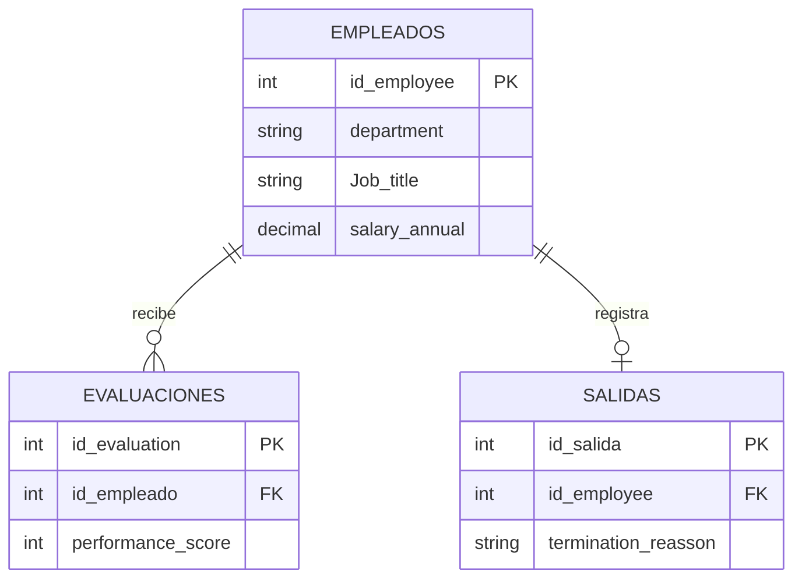

#Architettura de proceso y datos - People Analytics

#Offboarding(flujo de captura de datos)
```mermaid
flowchart TD
  A[Empleado presenta renuncia] -> B[HR registra fecha y motivo de salida]
  B -> C[Envio de encuesta Exit interview]
  C -> D{Encuesta completada?}
  D -> Sì -> E[Guardar respuestas en base de datos HR]
  D -> No -> F[Recordatorio automatico a los 3 dias]
  F -> E
  E -> G[Calculo de KPI de rotacion en R]
```

#Modelo entità-relazione (struttura dei dati)

